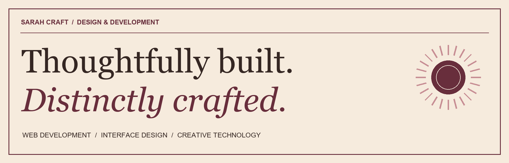

  

# Sarah Craft

**Web developer & designer · Arkansas**

I build useful web experiences with clear interfaces and a distinct visual point of view. My work brings together front-end development, typography, and visual design—from academic research tools to custom portfolio experiences.

I'm an A-State student and substitute teacher, seeking **junior web developer and creative technology opportunities**.

[Explore my portfolio](https://sarah-craft-portfolio.sarah-craft32780.chatgpt.site/) · [GitHub](https://github.com/sarahcraft1)

## Selected work

### Quillora
**An academic source discovery and organization tool.**

Built with Next.js, React, TypeScript, Tailwind CSS, and Crossref. Quillora helps students find scholarly source records, organize assignments, and prepare citations for review.

- Search scholarly source metadata through Crossref and follow DOI links to original sources.
- Extract assignment and rubric text from text-based PDFs and DOCX files, with editable requirements for student confirmation.
- Prepare APA and MLA citations, including quotation handling and metadata warnings.
- Save assignments and sources in browser-local storage, with JSON backup export and import.

**Status:** Developed and tested locally; preparing for a small student pilot. Hosting is paused, and the pilot has not launched. Citation details still need student review; access and peer-review status are not independently verified.

[View Quillora source](https://github.com/sarahcraft1/quillora)

### Sarah Craft Portfolio
**A retro-editorial home for web, design, and photography.**

A warm, typography-led portfolio featuring selected projects and interactive creative tools, including a drawing pad and pattern generator.

[Explore the portfolio](https://sarah-craft-portfolio.sarah-craft32780.chatgpt.site/)

### Butter & Bloom
**A bakery brand concept, from identity to packaging.**

A coordinated visual identity exploring color, typography, packaging, and presentation. A self-directed concept project showing the design thinking I bring to digital work.

[Find it in my portfolio](https://sarah-craft-portfolio.sarah-craft32780.chatgpt.site/)

## Tools & skills

**Development:** HTML, CSS, JavaScript, TypeScript, React, Next.js, Tailwind CSS  
**Workflow:** Git, GitHub, VS Code, responsive interface development  
**Design:** Figma, Adobe Illustrator, typography, visual identity, photography

## Connect

For projects, work samples, and contact options, visit [my portfolio](https://sarah-craft-portfolio.sarah-craft32780.chatgpt.site/). You can also explore my work here on [GitHub](https://github.com/sarahcraft1).

---

Considered interfaces. Useful tools. A little vintage character.
